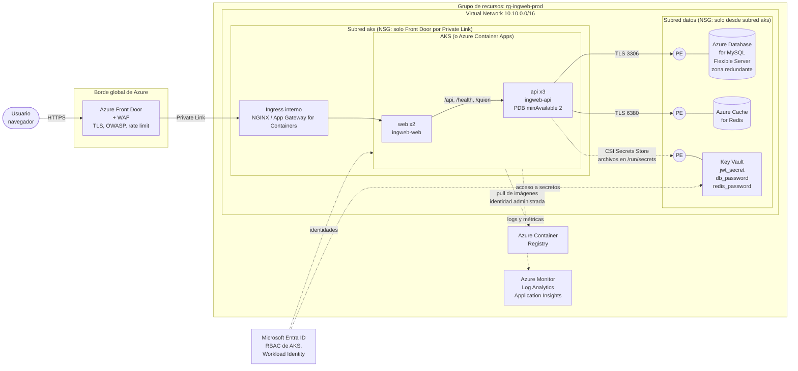

# Arquitectura de referencia en Azure

> Documento de diseño, **no de despliegue**. Explica cómo llevar a Azure lo
> que este repositorio ya corre en Docker Compose y en Kubernetes (kind),
> sin cambiar el código de la aplicación.

## 1. Punto de partida

| Pieza | Hoy (repo) | Imagen / tecnología |
|---|---|---|
| Web | Nginx sin privilegios que sirve React (Vite) y reenvía `/api` | `ingweb-web:1.0` |
| API | Flask + Gunicorn, sin estado, JWT HS256 | `ingweb-api:1.0` / `1.1` |
| Base de datos | MySQL 8.4 (Compose: contenedor; K8s: StatefulSet) | `mysql:8.4.7` |
| Caché | Redis 7.4 con contraseña, TTL 30 s, degradación elegante | `redis:7.4.6-alpine` |
| Secretos | Archivos en `/run/secrets` (Compose secrets / K8s Secret) | `*_FILE` |

La app ya lee cada secreto desde un **archivo** (`JWT_SECRET_FILE`,
`DB_PASSWORD_FILE`, `REDIS_PASSWORD_FILE`). Eso hace que el paso a Key Vault
no toque el código: el driver CSI de Key Vault monta los secretos como
archivos en la misma ruta.

## 2. Diagrama

> El diagrama es Mermaid: GitHub y VS Code (con extensión) lo dibujan solos.
> Para una imagen (PNG/SVG) del informe, pegarlo en <https://mermaid.live> y
> exportar. **Eso es manual.**

### Flujo de una petición

1. El navegador llama `https://ingweb.example/api/proyectos` con
   `Authorization: Bearer <JWT>`.
2. **Front Door + WAF** termina TLS, aplica reglas OWASP y de tasa, y reenvía
   por **Private Link** al ingress interno de AKS. AKS no tiene IP pública.
3. El ingress entrega a un pod `web` (Nginx), que reenvía `/api` al Service
   `api`. Es la misma configuración `proxy_pass http://api:8000` de hoy.
4. Una réplica de `api` verifica el JWT con `JWT_SECRET`, que es igual en
   todas porque sale del mismo Key Vault. Consulta Redis y, si no hay dato,
   MySQL. Ambos se alcanzan por **private endpoints**, nunca por internet.

## 3. Clasificación IaaS / PaaS / SaaS

| Componente | Servicio Azure | Modelo | Qué gestiona el equipo |
|---|---|---|---|
| Entrada global, TLS, WAF | Azure Front Door Premium + WAF | PaaS | Reglas WAF, dominios, certificados |
| Orquestación | AKS | PaaS (plano de control gestionado; los nodos son VMs del cliente) | Manifiestos, versiones de nodos, imágenes |
| Alternativa simple | Azure Container Apps | PaaS / *serverless* | Imágenes, escalado, revisiones |
| Registro de imágenes | Azure Container Registry | PaaS | Imágenes, escaneo, retención |
| Base de datos | Azure Database for MySQL Flexible Server | PaaS (DBaaS) | Esquema, usuarios, reglas de red, backups (retención) |
| Caché | Azure Cache for Redis | PaaS | Tamaño, contraseña o Entra ID, red |
| Secretos | Key Vault | PaaS | Qué secretos hay, quién los lee, rotación |
| Identidad | Microsoft Entra ID | SaaS / IDaaS | Usuarios, grupos, roles, MFA |
| Observabilidad | Azure Monitor, Log Analytics, Application Insights | PaaS / SaaS | Alertas, consultas, retención |
| Red | VNet, subredes, NSG, Private Endpoints | IaaS (red virtual) | Direccionamiento, reglas, DNS privado |
| (Contraejemplo) MySQL en una VM | Azure Virtual Machines | **IaaS** | Todo: SO, parches, MySQL, backups, HA |

Este proyecto **no usa SaaS de terceros** para datos: la base es MySQL propio.
Firebase, por ejemplo, sería SaaS/BaaS externo, fuera del perímetro de Azure.

## 4. Mapa de equivalencias: laboratorio → Azure

| En el repo | En Azure | Por qué |
|---|---|---|
| `secrets/*.txt` + Compose `secrets:` | Key Vault | Secretos fuera de imágenes y de Git, con auditoría y rotación |
| `kubectl create secret generic` (k8s-up.sh) | Key Vault + **CSI Secrets Store Driver** + Workload Identity | Los secretos llegan como archivos en `/run/secrets` sin pasar por un Secret de K8s en texto plano en etcd |
| `JWT_SECRET_FILE`, `DB_PASSWORD_FILE`… | Igual (sin cambios de código) | `leer_secreto()` ya lee archivos |
| Nginx (`web`) publicado en 8080 | Front Door + WAF → Ingress interno | TLS, WAF y CDN en el borde; Nginx sigue sirviendo estáticos |
| Service `web` NodePort 30080 | Service `LoadBalancer` interno / Ingress | NodePort es solo para kind |
| `kind load docker-image` | `az acr build` / `docker push` a ACR + `AcrPull` para AKS | Los nodos descargan de un registro privado |
| `imagePullPolicy: IfNotPresent` | Etiquetas inmutables (`1.0`, `1.1`) o *digest* | Nunca `:latest` |
| StatefulSet `mysql` + PVC | Azure Database for MySQL (zona redundante) | Backups, parches y alta disponibilidad gestionados |
| Deployment `redis` efímero | Azure Cache for Redis | SLA, TLS, réplica |
| 3 réplicas + `topologySpreadConstraints` por nodo | Nodos en **zonas de disponibilidad** (`topology.kubernetes.io/zone`) | Sobrevivir a la caída de un datacenter |
| PDB `minAvailable: 2` | Igual: AKS lo respeta al actualizar nodos | Actualizaciones de nodos sin caída |
| Rolling update `maxUnavailable: 0` | Igual (o revisiones con división de tráfico en Container Apps) | Despliegues sin caída |
| Red `backend` *internal* | Subred de datos con NSG + private endpoints | Los datos no son alcanzables desde internet |
| `read_only`, `cap_drop: ALL`, no root | Igual + Azure Policy para AKS (perfil *restricted*) | Mismo mínimo privilegio, verificado por política |
| `docker compose logs` / `kubectl logs` | Container Insights + Log Analytics | Logs centralizados y alertas |
| `/health` (liveness) | Igual + *health probe* de Front Door | Un solo contrato de salud |

## 5. Modelo de responsabilidad compartida aplicado a este proyecto

| Capa | Azure | El equipo |
|---|---|---|
| Datacenter, hardware, hipervisor | ✔ | |
| Red física, DDoS de infraestructura | ✔ | |
| Plano de control de AKS, parches de MySQL y Redis gestionados | ✔ | |
| **Red virtual**: subredes, NSG, private endpoints, reglas WAF | | ✔ |
| **Identidad**: quién administra AKS y Key Vault (Entra ID, RBAC, MFA) | | ✔ |
| **Identidad de la app**: registro, login y JWT HS256 (exp/iat/sub obligatorios, solo HS256, firma en tiempo constante) | | ✔ |
| **Autorización**: el rol no se elige al registrarse; un usuario solo edita o borra su cuenta | | ✔ |
| **Aplicación**: CSP y cabeceras de seguridad (Flask y Nginx), CORS restringido, escape de HTML (React), consultas parametrizadas (sin SQL injection) | | ✔ |
| **Datos**: esquema, usuario de BD con mínimo privilegio, backups (retención y pruebas de restauración), cifrado en tránsito (TLS a MySQL y Redis) | Compartido (Azure cifra en reposo) | ✔ |
| **Secretos**: generación, rotación, nunca en Git ni en imágenes | Key Vault guarda | ✔ decide y rota |
| **Contenedores**: imagen base fija y parcheada, usuario no root, raíz de solo lectura, sin capabilities | | ✔ |
| **TLS** público | Front Door emite y renueva certificados gestionados | ✔ configura dominio y HSTS |

Regla práctica: **Azure protege la nube; el equipo protege lo que pone en la
nube**. Pasar a PaaS reduce la columna del equipo (no parchea MySQL), pero
nunca la deja vacía: identidad, datos y código siempre son del cliente.

## 6. Diferencias con el diseño del reto (Azure SQL) y por qué no es contradictorio

El diseño de referencia del reto usa **Azure SQL Database** (SQL Server
gestionado). Este proyecto usa **MySQL**. Por eso aquí aparece **Azure
Database for MySQL Flexible Server**:

- **Mismo modelo y mismo rol**: las dos son bases relacionales PaaS
  gestionadas. Ofrecen backups automáticos, alta disponibilidad con zona
  redundante, private endpoints, cifrado en reposo e integración con Entra
  ID. En el diagrama ocupan exactamente la misma caja.
- **El motor lo decide la aplicación**: el código usa `mysql-connector-python`
  y SQL de MySQL (`AUTO_INCREMENT`, `ENGINE=InnoDB`, `utf8mb4`). Pasar a Azure
  SQL obligaría a reescribir el esquema y cambiar el driver, sin ganar nada
  para el reto. Mantener el motor permite que lo probado en Compose y kind
  sea lo mismo que corre en Azure.
- **Lo que no cambia**: la red privada, Key Vault, el usuario de la app sin
  privilegios de administrador y la responsabilidad del equipo sobre los
  datos. Todo lo del reto aplica igual.
- **Única configuración nueva**: en Azure hay que exigir TLS hacia MySQL
  (`require_secure_transport=ON` viene por defecto en Flexible Server). En el
  código bastaría agregar `ssl_ca` y `ssl_verify_cert` a `get_connection()`.
  Queda como paso pendiente si se despliega de verdad.

## 7. Riesgos y pendientes si se despliega de verdad

- **TLS a MySQL y Redis**: ver arriba. En el laboratorio la red interna no
  usa TLS.
- **Migraciones**: `init_db.py` (initContainer) solo crea tablas. Para
  cambios de esquema hace falta una herramienta de migraciones (p. ej.
  Alembic) ejecutada como Job antes del rollout.
- **Rotación de `JWT_SECRET`**: rotarlo invalida todos los JWT vigentes. Una
  rotación sin cortes necesita aceptar dos claves (campo `kid`). Hoy no está
  implementado.
- **Autorización de proyectos y tareas**: cualquier usuario autenticado puede
  editar cualquier proyecto o tarea. Es una decisión de dominio pendiente;
  ver `DECISIONES.md`.
- **Costos**: AKS más Front Door Premium no es barato para un proyecto
  académico. Container Apps con su ingress y Front Door Standard es la
  variante económica con el mismo diseño.
